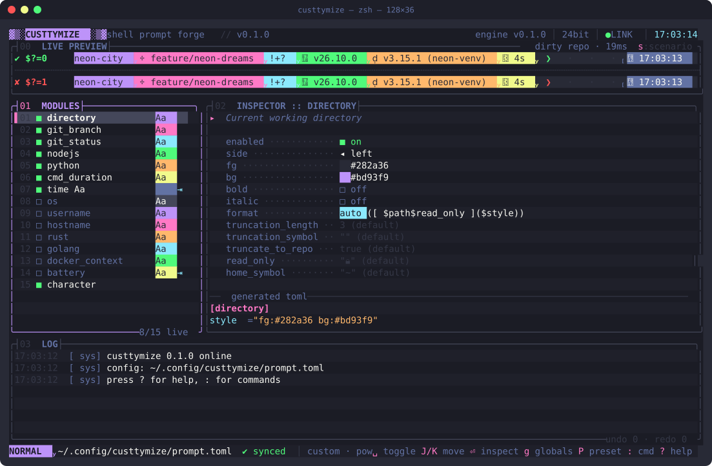
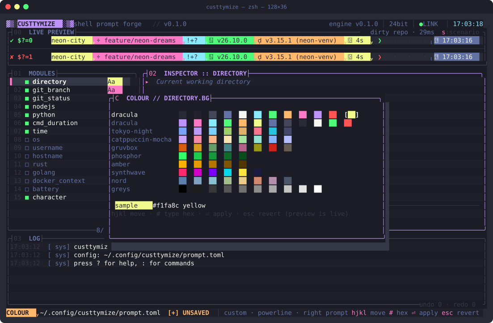
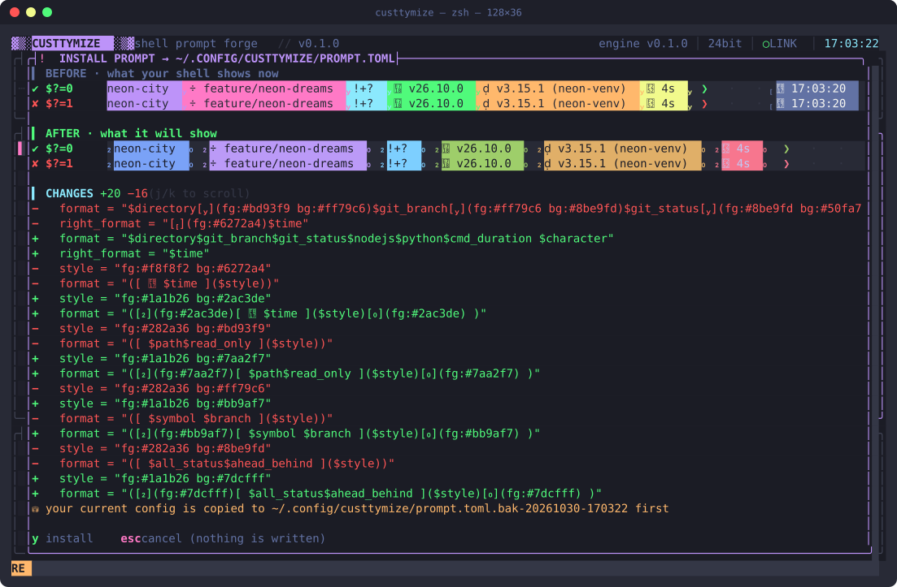
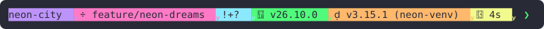
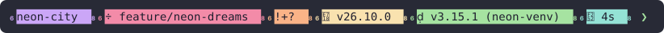

<h1 align="center">▓▒░ custtymize ░▒▓</h1>

<p align="center">
  <b>Design your shell prompt in a hacker console. Then run it, fast.</b><br>
  Its own prompt engine (no starship needed) · live preview · colour picker · presets &amp; shapes · before/after review · one-key backups
</p>

<p align="center">
  <a href="https://mikemich.github.io/custtymize/">Website</a> ·
  <a href="#install">Install</a> ·
  <a href="#keys">Keys</a> ·
  <a href="#commands-">Commands</a>
</p>

<p align="center">
  
  
  
</p>

<p align="center">
  
</p>

custtymize is two things in one binary:

* **An editor.** Pick modules, colours, shapes and presets, and watch the prompt update
  live in both success and error states. Nothing is written until you have seen the
  before, the after and the diff.
* **A prompt engine.** `custtymize prompt` renders that config on every Enter in your
  shell. The editor's preview calls the same code, so what you design is exactly what
  you get.

It reads and writes [Starship](https://starship.rs)'s config format, so an existing
`starship.toml` works out of the box, and you can take your config back to starship any
time. Starship itself isn't needed.

| | |
| --- | --- |
|  |  |
| **Colour picker** with live preview | **Review before install**: before, after, diff |

**Presets × shapes:**

<br>
<br>
<br>
<br>


## Install

Requires Rust 1.88+ and a Nerd Font in your terminal (e.g. JetBrains Mono Nerd Font)
for the powerline, rounded and slanted glyphs.

```bash
cargo install --git https://github.com/mikemich/custtymize
```

or from a clone:

```bash
cargo install --path .
```

### 1. Design

```bash
custtymize
```

On first run it starts from your `~/.config/starship.toml` if you have one, or from
defaults. `ctrl-s` reviews and saves to `~/.config/custtymize/prompt.toml`. Your
starship file is never touched.

### 2. Switch your shell over

Add one line to your shell's startup file (and remove `starship init` if it's there):

| shell | add to | line |
| --- | --- | --- |
| zsh | `~/.zshrc` | `eval "$(custtymize init zsh)"` |
| bash | `~/.bashrc` | `eval "$(custtymize init bash)"` |
| fish | `~/.config/fish/config.fish` | `custtymize init fish \| source` |

Open a new shell. To go back, put `starship init` back: your config is still
starship-compatible.

## Speed

Each prompt is one short-lived process. Modules run in parallel, the branch is read
straight from `.git/HEAD`, git status is a single `git status --porcelain=v2` call, and
tool versions (`node --version`, `python --version`, …) are cached between prompts. The
cache key is the binary's path and mtime plus any version-pin file (`.nvmrc`,
`.python-version`, `rust-toolchain.toml`, …), so upgrading a tool or changing projects
refreshes it.

Median of 30 runs on an M-series Mac. starship is measured as zsh runs it, once for the
left prompt and once for the right:

| config, directory | starship 1.27 | custtymize |
| --- | --- | --- |
| powerline, dirty repo with node + python | 144 ms | 11 ms |
| starship defaults, same repo | 148 ms | 12 ms |
| starship defaults, `~` | 141 ms | 8 ms |
| minimal one-line config, repo | 21 ms | 11 ms |

The biggest wins come from caching versions. On this machine, a pyenv `python` shim takes
130 ms to fail on every prompt before `python3` answers; custtymize remembers that.

See where the time goes in any directory:

```bash
custtymize timings
```

## Compatibility

custtymize implements starship's format language: `$var`, `${var}`, `[text](style)`,
`(conditional groups)`, escapes, `prev_fg` / `prev_bg`, `$all` and `$custom`. It also
uses starship's defaults, so an unedited `starship.toml` renders the same. That was
checked character by character, colours included, against starship 1.27 across these
cases:

* configs: defaults, powerline / rounded / slanted / flat, and a kitchen-sink config;
* directories: dirty, clean, detached, merging and rebasing repos, stashes,
  ahead/behind, `~`, `/`;
* environments: ssh and virtualenv;
* every exit-status case.

Supported modules: `directory`, `git_branch`, `git_commit`, `git_state`, `git_status`,
`character`, `cmd_duration`, `line_break`, `username`, `hostname`, `os`, `time`, `jobs`,
`status`, `sudo`, `battery`, `memory_usage`, `package`, `nodejs`, `python`, `rust`,
`golang`, `java`, `ruby`, `lua`, `zig`, `php`, `swift`, `deno`, `bun`, `kotlin`, `dart`,
`perl`, `terraform`, `docker_context`, `kubernetes`, `aws` and `custom.*`.

Other modules render empty, and the editor warns you about them when you save.

## CLI

| command | what it does |
| --- | --- |
| `custtymize` | open the editor |
| `custtymize prompt [--right] [--status N] [--cmd-duration MS] [--jobs N] [--shell zsh\|bash\|fish]` | print the prompt (the shell integration calls this) |
| `custtymize init <shell>` | print the shell integration script |
| `custtymize timings` | render here and show each module's time |

| flag | what it does |
| --- | --- |
| `-c, --config <PATH>` | config to use (default `$CUSTTYMIZE_CONFIG`, then `~/.config/custtymize/prompt.toml`, then starship's) |
| `--dry-run` | print the generated TOML to stdout and exit, writing nothing |
| `--preset <NAME>` | apply a palette preset first (works with `--dry-run`) |
| `--shape <SHAPE>` | apply a segment shape first (works with `--dry-run`) |
| `--print-preview` | render the prompt once in the preview sandbox, print the ANSI and exit |
| `--no-boot` | skip the boot sequence |
| `--ansi256` / `--truecolor` | force the UI colour depth (auto-detected otherwise) |

```bash
custtymize --dry-run --preset tokyo-night --shape powerline > ~/.config/starship.toml   # export for starship
```

## Keys

| key | action |
| --- | --- |
| `j` `k` / `↑` `↓` | move selection |
| `tab` | switch between module list and inspector |
| `space` | toggle module on/off |
| `J` `K` | move module down/up in `format` (`character` stays pinned last) |
| `R` | send module to the right prompt (`right_format`) |
| `a` / `D` | add / remove a module |
| `⏎` | edit the field: text inline, colours open the picker |
| `x` / `⌫` | reset field to default (format → generated, option → module default) |
| `p` | Nerd Font glyph picker (on the symbol field; `tab` from symbol edit too) |
| `g` | global options popup (layout, shape, cap, prompt char, colours, palette) |
| `S` `L` `C` `P` | cycle shape / layout / left cap / palette preset |
| `s` | cycle preview scenario: dirty repo, clean repo, deep path, ssh, home |
| `u` / `ctrl-r` | undo / redo |
| `ctrl-s` | install: opens the review screen (before/after prompts + diff); `y` writes |
| `B` | browse backups: preview each one, restore it or load it into the editor |
| `t` | full generated TOML, with `+` on lines that differ from disk |
| `y` | copy the generated TOML to the clipboard (`pbcopy`) |
| `?` | help |
| `q` / `ctrl-c` | quit (asks if there are unsaved changes) |

**Colour picker:** `hjkl` to move (the preview updates live), `#` to type a hex value,
`⏎` to apply, `esc` to revert. Rows: Dracula swatches, the active palette, every other
preset, and a grey ramp.

## Commands (`:`)

`tab` completes commands and arguments; `↑` `↓` walk the history.

| command | |
| --- | --- |
| `:w [path]` | validate → review before/after → back up → install (or save a copy to `path`) |
| `:backups` | browse, preview and restore previous setups |
| `:w!` | save even if the file changed on disk since it was loaded |
| `:q` / `:q!` / `:wq` / `:x` | quit / quit discarding / save & quit |
| `:preset <name>` | `dracula` `tokyo-night` `catppuccin-mocha` `gruvbox` `phosphor` `amber` `synthwave` `nord` |
| `:undo` / `:redo` | |
| `:export <path>` | validate and write the TOML elsewhere (e.g. `~/.config/starship.toml`) |
| `:shape <s>` | `powerline` `rounded` `slanted` `flat` `plain` |
| `:layout <l>` | `one` `two` `right` |
| `:cap <c>` | `gradient` (░▒▓) `rounded` `none` |
| `:char <glyph>` | prompt character |
| `:set <module>.<key> <value>` | e.g. `:set git_branch.bg #ff79c6`, `:set directory.truncation_length 2` |
| `:add <module>` / `:rm [module]` | add a module (catalog extras: `package` `java` `kubernetes` `aws` `memory_usage` `jobs` `status` `sudo` …) |
| `:scenario <s>` | preview context |
| `:toml` / `:yank` | view / copy the generated TOML |
| `:random` | random golden-angle colour scheme |
| `:reload[!]` / `:reset` | reload from disk / back to the last saved state |
| `:newline` | toggle `add_newline` |
| `:colors true\|256` | UI colour depth |
| `:clear` | clear the log |

## Safety

* **Preview before install.** Saving (`ctrl-s`, `:w`, `:wq`) never writes straight
  away. It opens a review screen with your **current** prompt and the **new** one,
  both rendered in success and error states, plus a line diff of the TOML. `y`
  installs; anything else cancels and nothing is written.
* **Backups.** Every install first copies the existing file to
  `prompt.toml.bak-YYYYmmdd-HHMMSS`. `B` (or `:backups`) lists every `*.bak*` next to
  your config, with a live preview of each. `⏎` restores one through the same review
  screen and backs up the current config first, so a restore can itself be undone.
  `l` loads a backup's modules and colours into the editor without touching the file.
* **Validation.** The TOML must parse and every format string must be valid, or the
  save is refused with the reason in the log pane. Modules the engine doesn't
  implement are reported as warnings.
* **A broken config never breaks your shell.** `custtymize prompt` always prints a
  prompt. If the config can't be read, it prints a plain fallback that tells you how to
  find out why.
* **Hostile repos can't run code.** Branch names and paths are shown literally. The zsh
  and bash integrations keep the rendered prompt in a variable that the shell expands
  once, so a branch named `$(rm -rf ~)` is just text.
* **Concurrent edits.** If the file changed on disk after custtymize loaded it, `:w`
  refuses; use `:w!` to overwrite or `:reload!` to discard your edits.
* **Round-trip.** Editing uses `toml_edit`, so comments, key order and anything
  custtymize doesn't manage survive. A no-op save is byte-identical: only modules you
  touched are rewritten. Literal text in your `format` (e.g. `[@](#727169)`) and modules
  outside the catalog (`${custom.foo}`, `$kotlin`) are kept verbatim as movable list
  entries.
* Symlinked configs (dotfiles repos) are written through the link, not over it.
* Writes are atomic (temp file + rename).

## How the preview works

The editor renders the working config in-process with the engine, for success and failure
in parallel, debounced by 60 ms. It runs inside a throwaway sandbox
(`~/Library/Caches/custtymize/playground/`). The sandbox has:

* a dirty git repo on `feature/neon-dreams` with modified, staged and untracked files;
* `Cargo.toml`, `package.json`, `go.mod` and `requirements.txt`;
* a fake `VIRTUAL_ENV`, plus `SSH_CONNECTION` for the ssh scenario.

Your own ssh and virtualenv state is masked so each scenario shows what it says.

## Architecture

```
src/
  main.rs               CLI (editor, prompt, init, timings), terminal setup, event loop
  error.rs              thiserror Error
  app.rs                App state machine: modes, input, commands, undo/redo, save
  preview.rs            background preview renderer, debounce, validation
  sandbox.rs            fake repos/scenarios for the preview
  engine/
    mod.rs              Context, render (parallel modules), validate, config lookup
    format.rs           format-string parser and evaluator
    style.rs            style strings → ANSI, zsh/bash escape wrapping
    util.rs             commands with timeouts, PATH lookup, version cache
    init.rs             zsh / bash / fish integration scripts
    modules/            directory, git, languages, system modules, custom
  model/
    mod.rs              Segment, Globals, Model (+ Shape/Layout/Cap enums)
    color.rs            Rgb, hex/style parsing, xterm-256 fallback, Dracula constants
    catalog.rs          per-module knowledge: body variables, symbol mode, options
    palette.rs          presets
  config/
    generate.rs         Model → TOML (format strings, separator chaining, minimal diff)
    load.rs             TOML → Model (best effort, lossless for what it can't model)
    save.rs             backup + atomic write
  ui/                   theme, boot, preview, modules, inspector, log, status, popups, matrix
```

### The segment model

```rust
pub struct Segment {
    pub name: String,                     // module: "git_branch", "custom.vpn"
    pub raw: bool,                        // unknown module: emitted verbatim, table untouched
    pub literal: Option<String>,          // literal format text, e.g. "[@](#727169)"
    pub enabled: bool,
    pub side: Side,                       // Left | Right (right_format)
    pub symbol: Option<String>,           // None = catalog default
    pub fg: Rgb,
    pub bg: Rgb,
    pub bold: bool,
    pub italic: bool,
    pub format_override: Option<String>,  // hand-written module format
    pub options: BTreeMap<String, OptValue>, // module-specific keys that are set
}
```

The generator splits the work between two places:

* Each module's own `format` holds the body wrapped in a conditional group, e.g.
  `([ $symbol $branch ]($style))`, so a module with nothing to show also hides its
  padding.
* The top-level `format` carries the separators for chained shapes. For powerline,
  every boundary is `[](fg:<prev bg> bg:<next bg>)`, or a thin `` when both
  neighbours share a background. Rounded and slanted segments carry their own caps, so
  they need no chaining.

## Tests

```bash
cargo test
```

The tests cover:

* **Engine:** format parsing and evaluation, conditional groups, nested styles,
  `prev_bg`, ANSI and shell escaping, git porcelain parsing, directory truncation,
  versions, durations, `$all` / `$custom`, validation and the init scripts.
* **Editor:** separator chaining, caps, layouts, style strings, comment and
  unknown-key preservation, byte-identical round trips, backups and palettes.

## Notes

* **Apple Terminal.** macOS 26's Terminal.app supports 24-bit colour but doesn't set
  `COLORTERM`, so custtymize detects it from `TERM_PROGRAM_VERSION`. If the colours look
  wrong, start with `--ansi256` (or run `:colors 256`).
* **Vi mode (zsh):** `character` switches to `vimcmd_symbol` in command mode.
* **bash** has no right prompt; `right_format` is ignored there.
* **fish** support is new: zsh and bash were tested in real sessions, fish wasn't.
* Not affiliated with the Starship project; custtymize just speaks its config format.
* Press `M`.

## License

[MIT](LICENSE)
